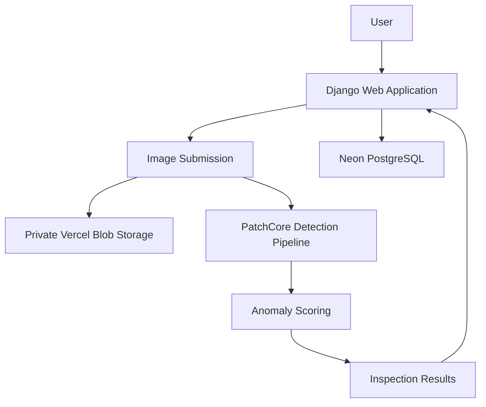

# ◈ VisionGuard
### Intelligent Industrial Visual Inspection | Deep Learning | Anomaly Detection

<p align="center">
  <strong>AI-powered visual inspection for identifying defects and anomalous patterns in industrial products.</strong>
</p>

<p align="center">
  <a href="https://visionguard-self.vercel.app/">
    
  </a>
  <a href="https://github.com/Suhrid2425/VisionGuard">
    
  </a>
</p>

<p align="center">
  
  
  
  
  
</p>

---

## 01 — Project Overview

**VisionGuard** is an AI-driven industrial visual inspection application designed to detect anomalous patterns and potential defects in product images using deep learning.

The system implements a PatchCore-based anomaly detection pipeline and combines it with a production-oriented web application built using Django.

VisionGuard brings together computer vision, backend engineering, database management, and cloud infrastructure to create an end-to-end visual inspection workflow.

### The Objective

Transform conventional image-based quality inspection into an AI-assisted process that can identify unusual visual patterns and support industrial quality control.

---

## 02 — Core Capabilities

<table>
  <tr>
    <td width="50%">
      <h3>◉ AI Anomaly Detection</h3>
      Deep learning-based visual inspection using a PatchCore detection pipeline.
    </td>
    <td width="50%">
      <h3>◈ Visual Analysis</h3>
      Processes submitted product images to identify anomalous patterns.
    </td>
  </tr>
  <tr>
    <td width="50%">
      <h3>▤ Inspection Management</h3>
      Django-powered workflow for image submission and inspection records.
    </td>
    <td width="50%">
      <h3>⬡ Cloud Infrastructure</h3>
      PostgreSQL database and private cloud image storage.
    </td>
  </tr>
</table>

---

## 03 — System Architecture

VisionGuard follows a modular architecture connecting the web application, anomaly detection pipeline, database, and cloud object storage.



### Processing Workflow

| Stage | Operation |
|---|---|
| 01 | User submits a product image |
| 02 | Image is stored in private Vercel Blob storage |
| 03 | Image enters the PatchCore-based detection pipeline |
| 04 | Model evaluates visual patterns and produces anomaly results |
| 05 | Django manages the inspection record |
| 06 | PostgreSQL stores persistent application data |
| 07 | Results are presented through the web interface |

---

## 04 — Technology Stack

| Layer | Technologies |
|---|---|
| Language | Python |
| Backend | Django |
| Deep Learning | TensorFlow, Keras |
| Anomaly Detection | PatchCore |
| Database | PostgreSQL, Neon |
| Object Storage | Vercel Blob |
| Deployment | Vercel |
| Version Control | Git, GitHub |

---

## 05 — Application Infrastructure

**Backend Architecture**

Django handles application routing, inspection workflows, database operations, and image-processing integration.

**AI Processing**

The PatchCore-based pipeline performs visual anomaly detection and generates inspection scores.

**Data Persistence**

Neon PostgreSQL provides persistent storage for inspection records and application data.

**Image Infrastructure**

Private Vercel Blob storage manages uploaded inspection images, accessed through the application's storage layer.

**Production Deployment**

The application is deployed on Vercel with production database connectivity and cloud-based image storage.

---

## 06 — Getting Started

### Prerequisites

- Python 3.12
- Git
- PostgreSQL connection
- Vercel Blob credentials

### Clone the Repository

```bash
git clone https://github.com/Suhrid2425/VisionGuard.git

cd VisionGuard
```

### Create a Virtual Environment

**Windows**

```powershell
py -3.12 -m venv .venv

.venv\Scripts\activate
```

**Linux / macOS**

```bash
python3.12 -m venv .venv

source .venv/bin/activate
```

### Install Dependencies

```bash
python -m pip install --upgrade pip

pip install -r requirements.txt
```

### Configure Environment Variables

Configure the following variables in your local environment:

```env
DJANGO_SECRET_KEY=your_secret_key
DATABASE_URL=your_postgresql_connection_string
BLOB_READ_WRITE_TOKEN=your_blob_token
```

Keep credentials private. Never commit `.env` files or production secrets to GitHub.

### Apply Database Migrations

```bash
python manage.py migrate
```

### Start the Application

```bash
python manage.py runserver
```

Open the application at:

`http://127.0.0.1:8000/`

---

## 07 — Production Deployment

<p align="center">
  <a href="https://visionguard-self.vercel.app/">
    
  </a>
</p>

| Component | Production Service |
|---|---|
| Application Hosting | Vercel |
| Database | Neon PostgreSQL |
| Image Storage | Private Vercel Blob |
| Application Framework | Django |

Production environment variables must be configured through Vercel project settings. Database migrations must be applied to the production database before database-dependent features are used.

---

## 08 — Future Development

- Interactive anomaly localization and heatmap visualization.
- Batch image inspection.
- Multi-category industrial inspection.
- Inspection history and image comparison.
- Advanced inspection analytics and reporting.
- Model evaluation using precision, recall, and other relevant metrics.
- Role-based access control and audit trails.

---

## 09 — Project Information

| Attribute | Details |
|---|---|
| Project | VisionGuard |
| Domain | Industrial AI / Computer Vision |
| Category | Deep Learning / Anomaly Detection |
| Architecture | Django + AI Processing Pipeline |
| Status | Deployed |
| Developer | Suhrid Mandal |

<p align="center">
  <a href="https://github.com/Suhrid2425">
    <strong>Suhrid Mandal</strong>
  </a>
  <br/>
  Artificial Intelligence Engineering
  <br/><br/>
  <a href="https://github.com/Suhrid2425/VisionGuard">GitHub Repository</a>
  &nbsp; · &nbsp;
  <a href="https://visionguard-self.vercel.app/">Live Application</a>
</p>

<p align="center">
  <strong>VISIONGUARD</strong>
  <br/>
  <sub>Engineering intelligent visual inspection through AI.</sub>
</p>
